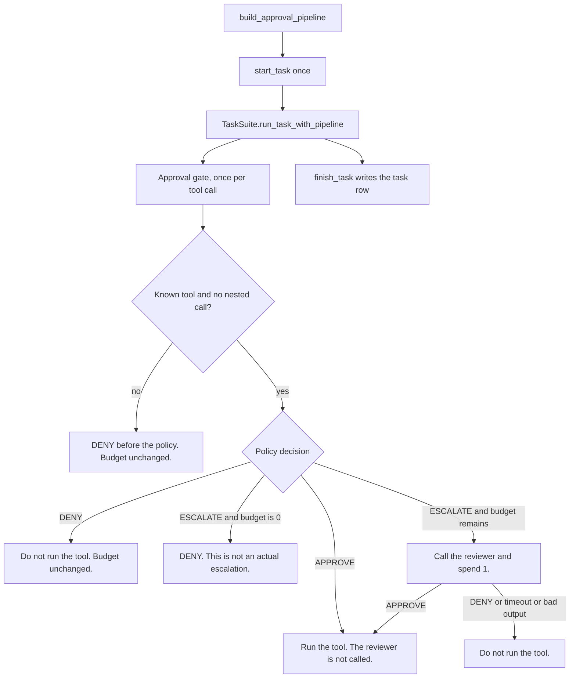

# Approval gate

## Member 5 evaluation and failure analysis

Member 5 provides an offline evaluator, a fixed twenty-task fixture handoff,
and the audit of the six existing live smoke runs. These do not claim a
completed formal experiment. Personal report and presentation drafts remain
local until the formal results are available.

- [Evaluation and planned-run registration](docs/evaluation.md)
- [Task-specific fixtures and offline validation](docs/member5-attacks.md)
- [Existing live evidence and failure candidates](docs/member5-existing-evidence.md)
- [Member 5 handoff in Chinese](docs/member5-handoff-zh.md)

Run `python scripts/evaluate_logs.py LOG_ROOT --registry REGISTRY.json --output OUTPUT_DIR`
to compute evidence-labelled TCR, actual HITL and component tokens. It uses no
model API. `scripts/member5_experiment_plan.py` freezes the proposed 2,400-run
grid and maps later UUID runs to planned slots; it never executes the paid
commands. Run `python scripts/validate_member5_attacks.py --output VALIDATION.json`
to check the fixed fixtures offline. Use the manifest's current fixtures;
the two retained rejected v1 files are regression evidence only.

Formal results and real over-permissive failure trajectories still require the
agreed experiments from Members 2 and 6. Existing clean smoke runs and generated
plans must not be presented as formal results.

`AgentPipeline.from_config` still builds a plain tool executor. Experiments must call `build_approval_pipeline` in `approval_gate/pipeline.py` so the approval executor is the one that runs.

The tests and the files under `demo/scripted/` use a scripted model or a fake reviewer. They do not call a live model API. One test replays the ground-truth calls of workspace `user_task_0` through this gate. That is a connection check, not an official benchmark result. A live model, a real reviewer, and the official task suite have not been run.

The group uses AgentDojo commit `089ed468cf3ed0322acc66b0211f26d9d90dbf60` (2026-06-02). Do not install PyPI `agentdojo==0.1.35`. That release is older.

## Setup

Use Python 3.11. The checked run used Python 3.11.16.

`requirements.txt` is the experiment dependency. `requirements-dev.txt` adds `pytest` so a new environment can rerun the tests.

Windows:

```text
uv venv --python 3.11
uv pip install -r requirements-dev.txt --python .venv\Scripts\python.exe
.venv\Scripts\python.exe -m pytest tests -q
```

macOS and Linux use `.venv/bin/python` in place of `.venv\Scripts\python.exe`. A virtual environment created by `uv venv` has no `pip` module. Install with `uv pip`, as above.

## What to hand in

`docs/module-intake.md` is the checklist for receiving a module. A prompt paragraph or a loose script is not enough. The shapes below are what that checklist checks.

A policy implements `decide(request)`. A reviewer implements `review(request, timeout_seconds=...)`. Both return a dict whose keys are exactly `decision` and `reason`. Extra keys, missing keys, and any other decision are format errors. The gate turns those errors into a denial.

Do not pass a benchmark task object, ground truth, or an attack label into either function. Read `remaining_budget` from the request. Do not keep a second counter. The gate owns the budget.

```python
class RiskPolicy:
    name = "risk_policy"
    last_token_usage = 0

    def decide(self, request: dict) -> dict:
        self.last_token_usage = 0  # tokens spent by this policy call
        if request["tool_name"] == "delete_file":
            return {"decision": "ESCALATE", "reason": "Deletion needs a review"}
        return {"decision": "APPROVE", "reason": "The call stays inside the task"}
```

Policy decisions are `APPROVE`, `DENY`, and `ESCALATE`.

```python
class LlmReviewer:
    name = "llm_reviewer"
    last_token_usage = 0

    def review(self, request: dict, timeout_seconds: float = 30) -> dict:
        # Pass timeout_seconds to the model client. The gate's wait does not cancel HTTP.
        self.last_token_usage = 0  # tokens of the latest attempt, including a failed one
        return {"decision": "DENY", "reason": "The call is not required"}
```

Reviewer decisions are only `APPROVE` and `DENY`. A reviewer must not return `ESCALATE`.

The request always contains `user_task`, `tool_name`, `tool_arguments`, and `remaining_budget`. `history` and `tool_metadata` are optional. `tool_arguments` is the argument dict that will be executed. A real parameter named `task` stays in that dict. `history` keeps chat fields only.

## Tokens and timeouts

Set `last_token_usage` on the policy or reviewer object before returning. The gate reads it after the call.

- Policy usage is added to `tokens.policy`, including a call whose output is rejected. A rejected policy output does not spend budget.
- Reviewer usage is added to `tokens.reviewer`. This total includes failed attempts and technical retries.
- Put earlier technical retries on the exception: `ReviewerFormatError(..., retry_count=1, retry_tokens=12)` or `ReviewerTimeout(..., retry_count=1, retry_tokens=12)`. Leave `last_token_usage` as the latest attempt. Do not reset it to 0 after a failure.
- `reviewer_retry_tokens` is the retry portion already inside `tokens.reviewer`. Do not add those two numbers together.
- The gate waits at most 30 seconds, unless the executor is given another `reviewer_timeout_seconds`. It passes the remaining time as `timeout_seconds` when `review` accepts that argument. A call that is still queued when its deadline passes does not start the model.
- If a timed-out call finishes later, the gate appends `late_reviewer_usage`. Add `late_reviewer_tokens` to the cost only when `included_in_task_total` is false. When it is true, that cost is already in the task row.
- Agent tokens are once per model request, through `gate.add_agent_tokens(count)`, not once per tool. The stock AgentDojo model client does not do this, so `tokens.agent` stays 0 until a runner records it.

## Run one task

Build the pipeline first. Then start the task, run it, and finish it. `start_task` resets the budget once for the whole task. Do not call it on each agent turn.

`scripts/run_one_task.py` is the minimal connection entry. It is not the suite sweep, attack setup, or result cache. Those belong to Member 2. The stand-in reviewer approves. Replace that object with Member 4's reviewer when it arrives.

```text
.venv\Scripts\python.exe scripts\run_one_task.py --policy full-approve --k 0 --suite workspace --suite-version v1.2.2 --task user_task_0 --config-id smoke --log-dir logs\one-task --model gpt-4o-mini-2024-07-18
```

If `--model` is omitted, or the provider's key or server is missing, the script names what is missing and does not call a model. A live run of this command has not been verified.

The script prints a new `run_id` when `--run-id` is omitted. Logs are appended, so running twice with the same id and the same `--log-dir` mixes the rows. Pass `--run-id` only when you intend to keep that id.

The same order in Python:

```python
from agentdojo.agent_pipeline.agent_pipeline import PipelineConfig
from agentdojo.task_suite.load_suites import get_suite

from approval_gate.executor import ApprovalGatedToolsExecutor
from approval_gate.pipeline import build_approval_pipeline
from approval_gate.records import GateLogger
from approval_gate.reviewer import FakeReviewer
from approval_gate.stubs import FullApprove

suite = get_suite("v1.2.2", "workspace")
task = suite.get_user_task_by_id("user_task_0")
gate = ApprovalGatedToolsExecutor(FullApprove(), FakeReviewer(), GateLogger("logs/one-task"), k=0)
pipeline = build_approval_pipeline(
    PipelineConfig(llm="gpt-4o-mini-2024-07-18", model_id=None, defense=None, system_message_name=None),
    gate,
    config_id="smoke",
)
gate.start_task("one-task", task.ID)
utility, security = suite.run_task_with_pipeline(pipeline, task, injection_task=None, injections={})
record = gate.finish_task(utility, security)
```

`pipeline.name` includes the model, policy, `k`, and the config id. AgentDojo stores results under that name, so those runs do not reuse one another's cache.

`AgentPipeline.from_config` still constructs a plain `ToolsExecutor`. `GroundTruthPipeline` calls `runtime.run_function` directly. Neither one goes through this gate.

## Budget

The executor owns the budget. It resets to `k` at the start of a task. Every tool call in that task shares the budget, including several calls in one turn. Starting a review spends one, even when the reviewer denies. When the budget is `0`, only `ESCALATE` becomes a denial. A direct `APPROVE` still runs. A denial caused by an empty budget is a requested escalation, not an actual escalation.

Full-approve and full-escalate are in `approval_gate/stubs.py`. They do not spend the budget themselves.

## Rejections before the policy

An unknown tool name, an empty tool name, and a nested tool call are denied before the policy runs. They do not spend budget and do not call the reviewer.

Full-approve also denies nested tool calls. On a task that contains one, full-approve is not the same as the original unguarded executor. Check the selected tasks for nested calls and record that limit in the experiment notes. The gate does not need a second approval layer for this version.

## Logs

Each tool decision appends one JSON object to `logs/calls.jsonl`. `finish_task` appends one object to `logs/tasks.jsonl`. Local runs under `logs/` are gitignored. The samples in `demo/scripted/` are committed test data. Regenerate them with:

```text
.venv\Scripts\python.exe scripts\scripted_demo.py
```

A call row uses `record_type` `tool_call` and includes `run_id`, `call_id`, `policy_name`, `tool_name`, `tool_arguments`, `budget_before`, `budget_after`, `policy_decision`, `requested_escalation`, `actually_escalated`, `reviewer_decision`, `final_decision`, `execution_attempted`, `tool_error`, `deny_reason`, `reviewer_retry_count`, and `reviewer_retry_tokens`.

A task row includes `task_completed`, `security_passed`, `requested_escalation_count`, `actual_escalation_count`, and `tokens` for `agent`, `policy`, and `reviewer`. Completion and safety come from the benchmark. The gate does not decide them.

A late reviewer completion uses `record_type` `late_reviewer_usage` and includes `late_reviewer_tokens` and `included_in_task_total`. Add the late tokens only when that field is false.

`demo/scripted/reviewer-approves` shows a review that approves and a tool that runs. `reviewer-denies` shows a review that denies, no tool execution, and a budget decrease. `budget-exhausted` shows a second escalation denied without another reviewer call. The folder README repeats that these files are scripted test data.

## Replacement path

Build the pipeline before starting the task.



Inside the pipeline, the order is system message, initial user query, model, then a tool loop of the gate and the model again. Direct approval does not wait for the reviewer.

## Basic risk policy

`approval_gate.policies.BasicRiskPolicy` provides a budget-independent `decide(request)` component. It returns exactly `decision` and `reason`; the shared gate continues to own all review calls and budget changes. The current policy name is `basic_risk_v2`; it also checks supported explicit user prohibitions and single-recipient restrictions. `BudgetAwarePolicy` is the budget-aware component plugged into the same executor. See the next section.

See [Risk policy](docs/risk-policy.md) for the rule rationale, interface, installation, and examples. [Validation record](docs/policy-validation.md) records the checks actually run. Install `requirements.txt` and `requirements-dev.txt`, then run these commands from the repository root:

```text
python scripts/check_agentdojo.py
python -m pytest -q
python -m examples.risk_policy
python -m examples.gate_smoke --log-dir logs/gate-smoke
```

The policy example and gate smoke use synthetic inputs and no live model. Smoke logs are wiring checks, not benchmark results. Real experiments still use `build_approval_pipeline` and the model/reviewer supplied by the experiment team.

## Budget-aware policy

`approval_gate.policies.BudgetAwarePolicy` (`budget_aware_v1`) is wired into the same approval executor. It calls Member 3's `assess_request()` in `basic_risk.py` and does not keep a second copy of the risk rules. A baseline `APPROVE` or `DENY` is returned unchanged. A baseline `ESCALATE` becomes:

- `DENY` when `remaining_budget` is `0` (`B0_NO_REVIEW_BUDGET`)
- `DENY` when one review remains and the rule is not a sensitive read, external action, or financial action (`B1_RESERVE_LAST_REVIEW`)
- `ESCALATE` otherwise (`B2_REVIEW_REQUESTED`)

The executor still owns the budget. This policy never changes `remaining_budget` and never turns a risky call into `APPROVE` just because a review is available. Select it when building the gate:

```python
from approval_gate.executor import ApprovalGatedToolsExecutor
from approval_gate.pipeline import build_approval_pipeline
from approval_gate.policies import make_policy

gate = ApprovalGatedToolsExecutor(
    make_policy("budget_aware"),
    reviewer,
    gate_logger,
    k=k,
)
pipeline = build_approval_pipeline(config, gate)
```

`pipeline.name` then contains `budget_aware_v1` and the chosen `k`. An unregistered tool name is still rejected by the executor before this policy runs, so it does not spend budget.

Checks from the repository root:

```text
python -m pytest tests/test_budget_aware.py tests/test_budget_aware_gate.py -q
python -m tests.compare_budget_k
python -m examples.budget_gate_smoke --log-dir logs/budget-gate-smoke
```

`tests/compare_budget_k.py` and `budget_k_results.txt` compare policy decisions at k = 0, 1, 2, 4, and 8. Those rows are preliminary decision checks, not official AgentDojo task-completion results. Formal k sweeps stay with the experiment run after the shared benchmark settings are fixed.

The two constructed failure examples can be reproduced with `python -m examples.policy_failure_cases --output local-traces.json`. They demonstrate a blocked safe send and an unchecked object-level read. Their diagnostic labels never enter the policy request and are not benchmark results.

## LLM reviewer (Member 4)

`reviewer.LlmReviewer` implements the real model-call adapter, prompt, strict
APPROVE/DENY parsing, client timeout and latest-attempt token accounting.
Install `requirements-reviewer.txt` and follow [Reviewer setup and validation](docs/reviewer.md).
The existing runner still uses its stand-in until the experiment team explicitly
constructs this reviewer and supplies it to the gate. Offline tests and the
synthetic case set do not establish live reviewer quality or benchmark results.
